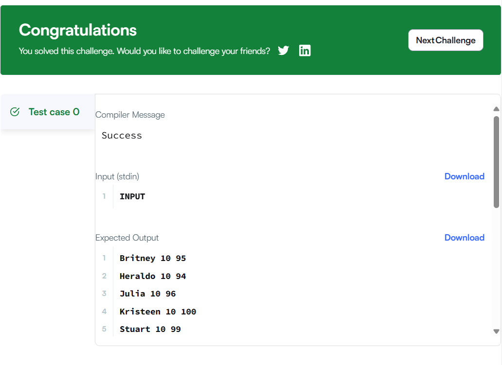
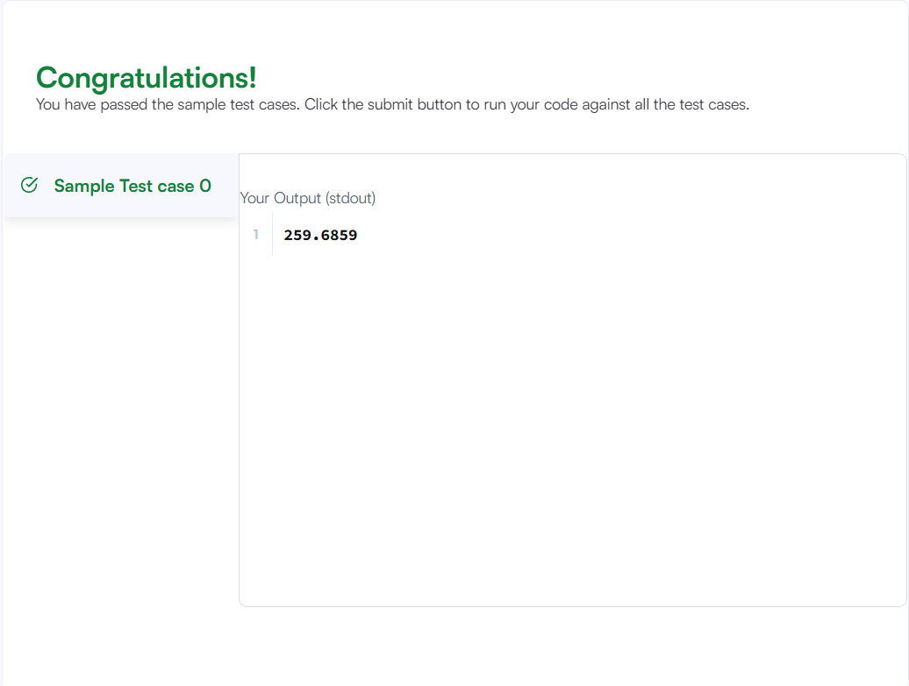
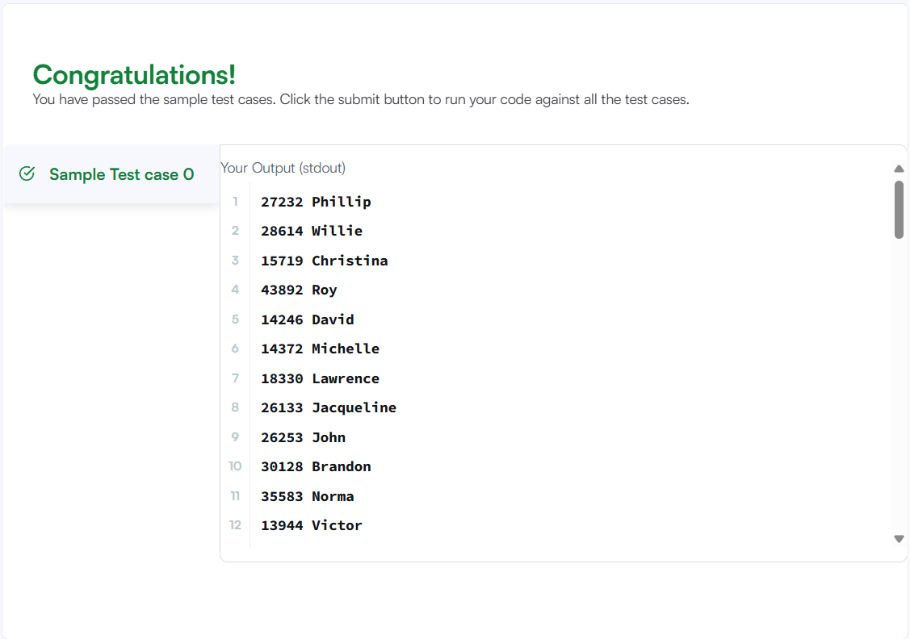
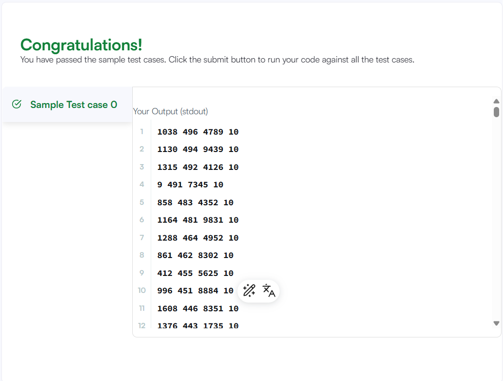
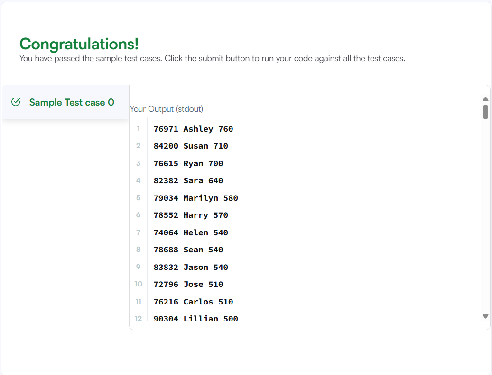

# Specialized SQL Techniques Assignment Answer

**Program:** Dibimbing - Batch 16 | DE  
**Dibuat Oleh:** Eka Arisman  

---

## Soal 1

**Pertanyaan:**
> *[The Report.](https://www.hackerrank.com/challenges/the-report/problem?isFullScreen=tru)*

**SQL Query:**
```sql
WITH students_grades AS (
    SELECT 
        s.name,
        s.marks,
        g.grade
    FROM students s
    JOIN grades g ON s.marks BETWEEN g.min_mark AND g.max_mark
)

SELECT 
    CASE WHEN grade < 8 THEN NULL ELSE name END,
    grade,
    marks
FROM students_grades
ORDER BY grade DESC, name, marks
```

**Hasil Query:**


---

## Soal 2

**Pertanyaan:**
> *[Weather Obeservation Station-18](https://www.hackerrank.com/challenges/weather-observation-station-18/problem?isFullScreen=true)*

**SQL Query:**
```sql
SELECT 
    CAST(
        ABS(MAX(lat_n)-MIN(lat_n))+ABS(MAX(long_w)-MIN(long_w)) AS DECIMAL(10,4)
    ) AS manhattan_distance
FROM station
```

**Hasil Query:**


## Soal 3

**Pertanyaan:**
> *[Top Competitors](https://www.hackerrank.com/challenges/full-score/problem?isFullScreen=true)*

**SQL Query:**
```sql
SELECT
    h.hacker_id,
    h.name
FROM hackers h
JOIN submissions s ON h.hacker_id = s.hacker_id
JOIN challenges c ON s.challenge_id = c.challenge_id
JOIN difficulty d ON c.difficulty_level = d.difficulty_level
WHERE s.score = d.score
GROUP BY h.hacker_id, h.name
HAVING COUNT(DISTINCT s.challenge_id) > 1
ORDER BY COUNT(DISTINCT s.challenge_id) DESC, h.hacker_id
```

**Hasil Query:**


## Soal 4

**Pertanyaan:**
> *[Ollivander's Inventory](https://www.hackerrank.com/challenges/harry-potter-and-wands/problem?isFullScreen=true)*

**SQL Query:**
```sql
WITH wands_details AS (
    SELECT
        w.id,
        wp.age,
        w.coins_needed,
        w.power,
        MIN(w.coins_needed) OVER(
            PARTITION BY wp.age, w.power
        ) AS coins_min
    FROM wands w
    JOIN wands_property wp ON w.code = wp.code
    WHERE wp.is_evil = 0
)

SELECT
    id,
    age,
    coins_needed,
    power
FROM wands_details
WHERE coins_needed = coins_min
ORDER BY power DESC, age DESC
```

**Hasil Query:**


## Soal 5

**Pertanyaan:**
> *[Contest Leaderboard](https://www.hackerrank.com/challenges/contest-leaderboard/problem?isFullScreen=true)*

**SQL Query:**
```sql
WITH max_scores AS (
    SELECT 
        hacker_id,
        challenge_id,
        MAX(score) AS max_score
    FROM submissions 
    GROUP BY hacker_id, challenge_id  
)

SELECT
    h.hacker_id,
    h.name,
    SUM(ms.max_score) AS total_score
FROM max_scores ms
JOIN hackers h ON ms.hacker_id = h.hacker_id
GROUP BY h.hacker_id, h.name
HAVING SUM(ms.max_score) > 0
ORDER BY total_score DESC, h.hacker_id 
```

**Hasil Query:**


## Reflection Questions

[Reflection Questions: Case Study Advanced SQL Queries](https://docs.google.com/document/d/1VZ86kzJ58TLcfhjXQdnc6UzW4sD2-BvwQa2epUy2A9Q/edit?usp=sharing)
